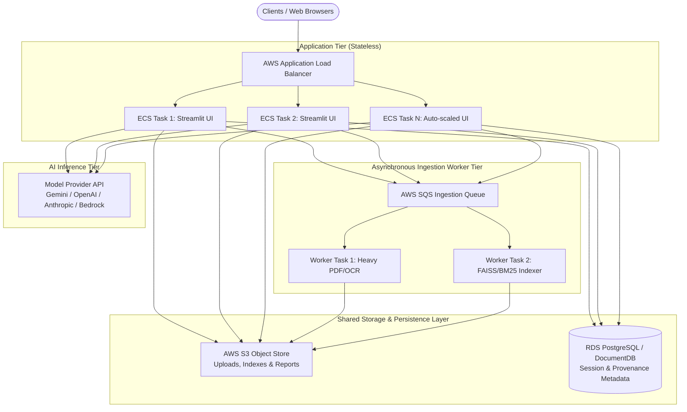

# 🚀 FIN SIGHT AI — Scaling & Cloud Deployment Architecture

This document details the multi-tier scaling architecture for **FIN SIGHT AI**, distinguishing between **Application Scaling**, **Document-Processing Scaling**, **AI Inference Scaling**, and **Vector Index Storage Scaling**.

---

## 1. Architectural Scaling Dimensions



---

## 2. Horizontal Scaling (Scale-Out)

### Application Tier (Stateless Instances)
- **Stateless App Containers:** Session metadata is dissociated from node-local storage.
- **Shared Storage Interface:** All uploaded files, extracted indices, and compiled reports are accessed through `src/storage/storage_adapter.py` (`LocalStorageAdapter` for single-node / `S3StorageAdapter` for cloud).
- **Sticky Sessions:** AWS ALB configured with cookie-based stickiness (`AWSALB`) to maintain WebSocket connections across Streamlit page transitions.
- **Health Checks:** Streamlit native health check endpoint `/_stcore/health` is polled by ALB every 15–30 seconds.

### Multi-Instance Load Balancer Configuration (AWS ALB)
```yaml
# AWS ALB Target Group Health Check Specs
TargetGroup:
  Protocol: HTTP
  Port: 8501
  HealthCheckPath: /_stcore/health
  HealthCheckIntervalSeconds: 30
  HealthCheckTimeoutSeconds: 5
  HealthyThresholdCount: 2
  UnhealthyThresholdCount: 3
  TargetType: ip
```

---

## 3. Vertical Scaling (Scale-Up & Resource Sizing)

### Memory Profiling & Sizing Guidelines
| Document Workload | Size Profile | Min Memory (Container) | Min CPU (Container) | Ingestion Target |
| :--- | :--- | :--- | :--- | :--- |
| **Small (Quarterly Filing)** | 1–10 pages (~30k chars) | 1 GB RAM | 0.5 vCPU | < 2.0s |
| **Medium (Annual 10-K)** | 10–50 pages (~150k chars) | 2 GB RAM | 1.0 vCPU | < 6.0s |
| **Large (Institutional Report)** | 50–250 pages (~750k chars) | 4 GB RAM | 2.0 vCPU | < 18.0s |
| **Batch / Multi-Company** | 5+ files simultaneously | 8 GB RAM | 4.0 vCPU | Asynchronous |

### Memory Management Optimizations
- **Generator-based Chunking:** Pages are processed sequentially rather than reading entire document structures into memory multiple times.
- **FAISS Flat Index:** Uses compact memory layouts; disk serialization is handled via `faiss.write_index`.
- **LRU Cache Protection:** Analysis computations and financial ratios are cached in `st.session_state["analysis_cache"]` to prevent redundant recalculation.

---

## 4. Scale-Down & Resource Reclamation

To prevent cost overruns and memory leaks when workloads subside:
1. **TTL-based Temporary Cleanup:** `StorageAdapter.cleanup_old_files(max_age_hours=48)` removes stale temporary files.
2. **Dynamic Worker Scaling:** ECS Service Auto Scaling scales worker tasks down to a minimum count (e.g., 1 or 2) when SQS `ApproximateNumberOfMessagesVisible == 0`.
3. **Index Reuse:** Unchanged documents are matched via MD5 hashes (`compute_document_id`), avoiding re-extraction and re-embedding.
4. **PyMuPDF Document Finalizers:** Context managers ensure document file handles and pixmaps are freed immediately after page rendering.

---

## 5. AWS Production Deployment Architecture

### 1. AWS Services Breakdown
- **AWS ECS with Fargate:** Container execution with zero server management.
- **Application Load Balancer (ALB):** SSL termination, WebSocket support, and round-robin routing with sticky sessions.
- **Amazon S3:** Encrypted storage for source PDFs, spreadsheets, FAISS indices, and PDF reports.
- **Amazon CloudWatch:** Logs, process metrics, and alerts on memory/CPU thresholds (`CPUUtilization > 75%`).
- **AWS Secrets Manager / SSM:** Secure injection of `GEMINI_API_KEY`, `OPENAI_API_KEY`, or `ANTHROPIC_API_KEY`.

### 2. Auto-Scaling Target Tracking Policy (CloudFormation / Terraform)
```hcl
resource "aws_appautoscaling_policy" "ecs_cpu_scaling" {
  name               = "fin-sight-cpu-scaling"
  policy_type        = "TargetTrackingScaling"
  resource_id        = aws_appautoscaling_target.ecs_target.resource_id
  scalable_dimension = aws_appautoscaling_target.ecs_target.scalable_dimension
  service_namespace  = aws_appautoscaling_target.ecs_target.service_namespace

  target_tracking_scaling_policy_configuration {
    target_value       = 70.0
    scale_in_cooldown  = 300
    scale_out_cooldown = 60

    predefined_metric_specification {
      predefined_metric_type = "ECSServiceAverageCPUUtilization"
    }
  }
}
```

---

## 6. Live Benchmarking Tool
FIN SIGHT AI includes an automated benchmark runner in the **System Performance & Scalability** page (`pages/8_System_Performance.py`). It measures real-time chunking throughput, memory usage, and BM25 retrieval latency across synthetic Small (5 pages), Medium (25 pages), and Large (100 pages) documents.
